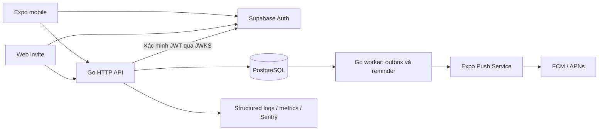

# NO PLANS — Thiết kế MVP

Ngày: 01/11/2026. Trạng thái: đề xuất để duyệt trước triển khai.

## Nguồn và phạm vi

Nguồn sản phẩm: `D:/Download/NO-PLANS_start-up.pdf` (11 trang).
Nguồn kỹ thuật: `D:/Download/NO_PLANS_Tech_Stack_System_Architecture (1).md` (file kết thúc giữa mục 3).
Nội dung trong hai file được dùng làm yêu cầu tham khảo; trạng thái “Concept Approved” trong PDF không được hiểu là phê duyệt triển khai hay phát hành của người dùng.

Mục tiêu: giúp nhóm bạn tại Việt Nam tạo và chốt cuộc hẹn nhanh hơn trao đổi trong nhóm chat. Chỉ số chính: số nhóm quay lại tạo kèo mỗi tuần.

## Quyết định đề xuất

- Mobile: React Native + Expo + TypeScript, Android và iOS dùng chung mã nguồn.
- API: Go modular monolith, sở hữu toàn bộ quyền truy cập và nghiệp vụ. Đây là lựa chọn đề xuất để giải quyết khác biệt với PDF dùng Supabase backend.
- PostgreSQL là nguồn dữ liệu chuẩn; Supabase Auth chỉ cung cấp danh tính. Mobile không ghi trực tiếp vào bảng nghiệp vụ.
- Worker Go cùng codebase, tiến trình riêng, đọc transactional outbox trong PostgreSQL; chưa cần Redis hay microservices.
- Web invite tối giản: xem thông tin giới hạn qua token; cần đăng nhập để RSVP, bỏ phiếu hoặc tham gia nhóm.
- Push qua Expo Push Service; dùng development build để kiểm thử thiết bị thật. AdMob chỉ tích hợp sau luồng lõi và cấu hình phê duyệt, consent, test ads.
- Triển khai phát triển bằng Docker Compose; production cần tài khoản dịch vụ, domain và lựa chọn hosting riêng.

Các lựa chọn trên do trợ lý đề xuất, chưa phải quyết định đã được người dùng duyệt. Phiên bản SDK và thư viện sẽ được kiểm tra tài liệu chính thức lúc triển khai.

## Kiến trúc

Module: identity, friends, groups, plans, voting, discovery, notifications, safety. API stateless; mọi thay đổi nghiệp vụ và bản ghi outbox cùng transaction. Push không phải nguồn dữ liệu chuẩn: khi mở thông báo, ứng dụng tải lại trạng thái qua API.

## Phân kỳ triển khai

1. Nền tảng chạy local: cấu trúc repo, migration, cấu hình, health check, seed dữ liệu mẫu, tài liệu chạy.
2. Vertical slice: xác thực, tạo nhóm, tạo kèo, mời thành viên, RSVP, chốt/hủy; giao diện mobile và web invite sử dụng API thật.
3. Bình chọn, khám phá dữ liệu tuyển chọn, worker push và nhắc lịch, lịch sử kèo.
4. Chặn/báo cáo, giới hạn lời mời, đo lường, kiểm thử thiết bị và hoàn thiện trước beta.
5. AdMob và phát hành sau khi có tài khoản, cấu hình và phê duyệt cần thiết.

Không làm trong MVP: chat, kèo công khai, AI recommendation, thanh toán, đặt bàn, merchant dashboard, feed và gamification.

## Mô hình dữ liệu

Tất cả ID nghiệp vụ dùng UUID; thời gian lưu UTC bằng timestamptz và hiển thị theo timezone người dùng, mặc định Asia/Ho_Chi_Minh.

| Bảng | Nội dung và ràng buộc chính |
|---|---|
| users | ID gắn với auth subject, tên hiển thị, avatar, trạng thái xóa |
| friendships | Cặp user chuẩn hóa và unique, requester, pending/accepted; không tự kết bạn |
| blocks | blocker, blocked unique; chặn lời mời và tương tác tương ứng |
| groups / group_members | Owner, tên; membership unique, role owner/member; quyền mute |
| plans | Owner, group tùy chọn, title, activity, starts_at, capacity, status, selected_option_id, version |
| plan_members | Plan + user unique; invited/going/not_going/maybe; lịch sử phản hồi qua audit |
| invite_links | Hash token ngẫu nhiên, scope, expires_at, revoked_at, max_uses, use_count |
| place_options / votes | Option thuộc plan; mỗi user có một phiếu mỗi plan; FK ngăn chọn option từ plan khác |
| places | Dữ liệu tuyển chọn, khu vực, khoảng giá, loại hoạt động, nguồn dữ liệu |
| devices / preferences | Token theo thiết bị, nền tảng, quyền push, mute và nhắc lịch |
| outbox / deliveries | Event, thời điểm xử lý, lease, attempt, retry_at; delivery unique theo event + recipient + device |
| reports / audit_events | Báo cáo và thao tác quan trọng, không chứa token hoặc nội dung nhạy cảm không cần thiết |

## Quy tắc nghiệp vụ

- Kèo: inviting → confirmed → completed; inviting hoặc confirmed → cancelled. Không mở lại kèo đã kết thúc/hủy trong MVP.
- Chỉ chủ kèo sửa, mời, chốt và hủy. Thành viên chỉ đọc kèo mình có quyền, sửa RSVP và phiếu của chính mình.
- Chủ kèo mặc định tham gia và tính vào sức chứa. Capacity phải lớn hơn 0 hoặc bỏ trống.
- RSVP đi: khóa hàng plan trong transaction, kiểm tra trạng thái, giờ bắt đầu và capacity trước cập nhật. Gửi lại cùng RSVP không tạo thêm người hay push.
- Cho phép đổi RSVP khi inviting hoặc confirmed và trước giờ bắt đầu. Khi đã chốt, khóa bình chọn; thay đổi giờ/địa điểm bởi chủ kèo phải phát sự kiện thông báo mới.
- Chốt cần thời gian ở tương lai và địa điểm rõ ràng; kết quả bình chọn chỉ là gợi ý, chủ kèo quyết định. Hòa phiếu không tự chọn ngẫu nhiên.
- Snapshot thành viên nhóm tại lúc mời. Người vào nhóm sau không tự được thêm vào kèo cũ. Rời nhóm không tự xóa RSVP; chủ kèo có thể thu hồi lời mời.
- Link là bearer secret có thể thu hồi, mặc định hết hạn sau 7 ngày. Preview chỉ trả tiêu đề, loại hoạt động và thời gian; không lộ danh sách thành viên hoặc địa chỉ chi tiết. Đăng nhập + redeem mới trở thành thành viên.
- Link redeem kiểm tra block, hết hạn, số lượt dùng và trạng thái plan trong transaction; người đã tham gia redeem lại không tiêu thêm lượt.
- Nhóm và kèo riêng tư mặc định. Không thu thập vị trí nền; khám phá MVP chọn khu vực thủ công.

## API dự kiến

Prefix `/v1`, JSON, bearer JWT; lỗi có code ổn định và request_id. List dùng cursor và giới hạn page size. Mutation tạo mới hỗ trợ Idempotency-Key theo user + route, lưu hash request và kết quả.

| API | Mục đích |
|---|---|
| GET /me; PATCH /me | Hồ sơ |
| POST /friend-requests; POST /friend-requests/{id}/accept | Kết bạn |
| GET/POST /groups; POST/DELETE /groups/{id}/members/{userId} | Quản lý nhóm |
| GET/POST /plans; GET/PATCH /plans/{id} | Danh sách, tạo và cập nhật kèo |
| POST /plans/{id}/invitations | Mời người có quyền mời |
| PUT /plans/{id}/rsvp | RSVP của người đang đăng nhập |
| POST /plans/{id}/options; PUT /plans/{id}/vote | Đề xuất, bình chọn |
| POST /plans/{id}/confirm; POST /plans/{id}/cancel | Chuyển trạng thái |
| POST /plans/{id}/invite-links; DELETE /invite-links/{id} | Phát và thu hồi link |
| GET /invite-preview; POST /invite-redeem | Token truyền qua header, không log |
| GET /places | Lọc loại hoạt động, khu vực, ngân sách |
| PUT /devices/{id}; DELETE /devices/{id} | Đăng ký và thu hồi push |
| POST /blocks; POST /reports | Kiểm soát an toàn |

Không nhận user_id từ client để xác định người thực hiện. JWT kiểm tra signature, issuer, audience, expiry. API thực thi kiểm tra membership mỗi request; database dùng role hạn chế quyền, không public bảng nghiệp vụ.

## Push, đồng bộ và độ tin cậy

- Worker lease bằng `FOR UPDATE SKIP LOCKED`; retry exponential backoff có jitter, giới hạn số lần và dead-letter để kiểm tra.
- Xử lý Expo tickets/receipts; vô hiệu token không còn hợp lệ. Semantics at-least-once: client dedupe theo event ID; không hứa gửi đúng một lần.
- Mute, block và quyền thông báo được kiểm tra lại trước khi gửi. Gộp RSVP, giới hạn lời mời theo actor/recipient/group và áp dụng rate limit API.
- Reminder gắn version lịch hẹn; kiểm tra lại status và starts_at trước khi gửi để tránh lịch cũ sau chỉnh sửa/hủy.
- MVP đồng bộ bằng refetch sau mutation, khi foreground và polling có backoff trên màn chi tiết. Push kích hoạt refetch. Realtime socket để sau nếu thử nghiệm cho thấy cần; không gọi polling là realtime tuyệt đối.

## Vận hành và bảo mật

Secrets chỉ ở backend; mobile chỉ có public auth config. Không log JWT, invite token, push token. TLS production, request size/timeout, validation và CORS allowlist. Backup PostgreSQL hàng ngày, thử restore trước beta. Quy trình xóa tài khoản phải thu hồi token thiết bị, ẩn danh hồ sơ và có chính sách retention rõ ràng trước phát hành.

Mục tiêu beta đề xuất: API p95 dưới 500ms không tính dịch vụ ngoài; outbox bình thường xử lý trong 60 giây. Đây là mục tiêu đo kiểm, chưa phải SLA. Theo dõi latency, error rate, pool DB, outbox lag, push failures và tỷ lệ chốt kèo; không thu nội dung riêng tư vào analytics.

## Kiểm chứng bắt buộc

- Integration test PostgreSQL cho RSVP đồng thời khi còn một chỗ, redeem link đồng thời, idempotency và transaction outbox.
- Kiểm thử truy cập chéo user/group, block, link hết hạn/thu hồi, JWT sai issuer/audience.
- Test chuyển trạng thái, khóa phiếu khi chốt, thay đổi lịch và reminder cũ.
- Test worker retry, crash sau gửi, receipt token lỗi và mute.
- Luồng thiết bị thật: đăng nhập → tạo nhóm → mời → RSVP → bỏ phiếu → chốt → mở push/deep link.

## Điểm cần xác nhận trước triển khai

## Bổ sung sau rà soát triển khai

- Đăng nhập MVP đề xuất email/password, xác minh email trước khi gửi lời mời; profile tạo idempotent ở lần gọi API đầu. Local dùng Supabase CLI Auth, không có đường bypass JWT trong production.
- Chủ nhóm quản lý thành viên; phải chuyển owner trước khi rời nhóm. Người bị thu hồi membership kèo mất quyền đọc/ghi ngay.
- Chủ kèo bấm kết thúc sau starts_at; chưa tự hoàn tất theo thời lượng giả định. Không giảm capacity dưới số người đang đi. PATCH dùng version/If-Match và trả conflict khi có sửa đồng thời.
- Link mở web có token trong URL fragment; frontend gửi header cho API, không đưa vào analytics/log. Áp dụng Referrer-Policy no-referrer; giữ token trong session để tiếp tục sau đăng nhập, xóa sau redeem. Deep link phải được kiểm thử cả trường hợp chưa cài ứng dụng.
- Web MVP đề xuất cho xem preview, đăng nhập và RSVP; bỏ phiếu/quản lý đầy đủ trên mobile.
- Màn hình vertical slice: đăng nhập, danh sách kèo, nhóm và thành viên, tạo kèo, chi tiết/RSVP/chốt/hủy, web invite. Tiêu chí nghiệm thu: hai tài khoản có thể chạy trọn luồng với dữ liệu bền vững qua restart; tài khoản thứ ba không có lời mời không đọc được chi tiết; tranh chỗ cuối không vượt capacity.

Đề xuất bắt đầu bằng vertical slice mobile Expo + API Go + PostgreSQL, dùng Supabase Auth cho đăng nhập; sau đó mở rộng đủ MVP theo các giai đoạn trên. Chưa thực hiện scaffold, cài dependency, tạo dịch vụ đám mây hoặc phát hành.
