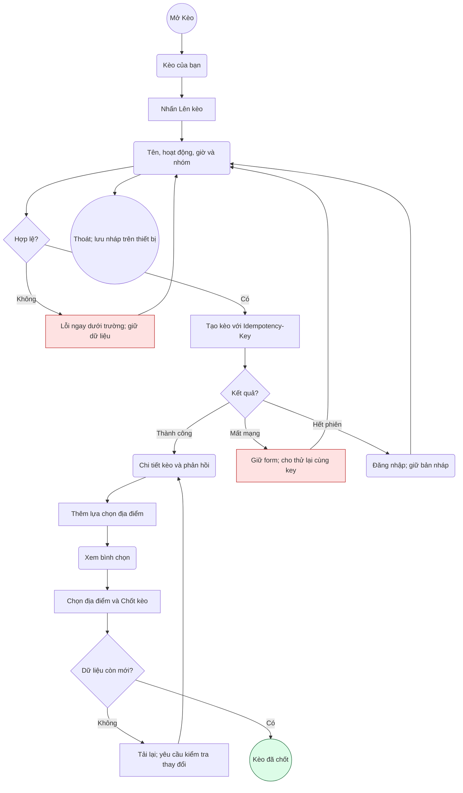
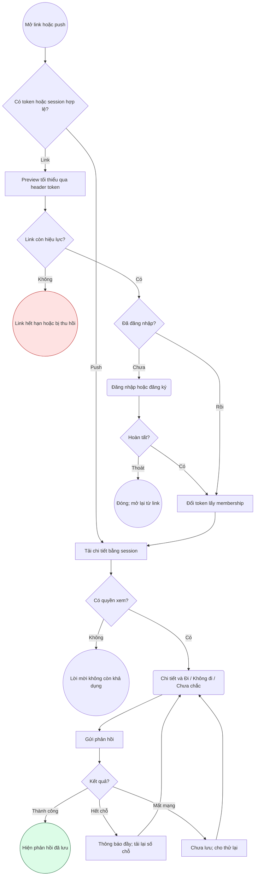

# NO PLANS — Luồng và đặc tả màn hình MVP

Áp dụng user-flow-mapping, wireframing và frontend-design từ bộ design-and-ui-ux người dùng yêu cầu. Đây là đặc tả để triển khai, chưa phải ảnh chụp UI đã chạy. Các số đo conversion hiện chưa có dữ liệu; không dùng số liệu ví dụ của skills làm kết quả sản phẩm.

## Tạo và chốt kèo

Mục tiêu: chủ nhóm tạo một cuộc hẹn, nhận phản hồi rồi chốt nơi gặp. Entry: tab Kèo hoặc CTA Lên kèo. Thành công: API xác nhận status confirmed và danh sách thành viên được tải lại.



Đo event create_started, create_succeeded, confirm_succeeded bằng ID nội bộ và thời gian; không ghi tên kèo, vị trí hoặc danh sách bạn. Rủi ro rớt luồng: nhập thời gian và chọn nhóm; dùng mặc định giờ tương lai và nhóm gần nhất, có thể sửa rõ ràng.

## Mở lời mời và trả lời



Đo invite_previewed, invite_redeemed, rsvp_succeeded. Điểm có thể rớt: tạo tài khoản; preview cho thấy giá trị trước đăng nhập và khôi phục lời mời sau xác thực. Không hiển thị thành viên/địa chỉ chi tiết trên preview.

## Wireframe: Kèo của bạn

```text
┌─────────────────────────────────┐
│ NO PLANS                  Hồ sơ │
│ Bớt bàn. Đi thôi.               │
│ Kèo của bạn          + Lên kèo  │
│ [Sắp tới] [Lời mời] [Đã qua]    │
│ ┌─────────────────────────────┐ │
│ │ Đang mời · Cà phê           │ │
│ │ Cà phê cuối tuần            │ │
│ │ T7, 19:30 · Chưa chốt quán  │ │
│ │ 3 đi · 2 chưa phản hồi      │ │
│ │ Xem kèo →                  │ │
│ └─────────────────────────────┘ │
│                                 │
│ [Kèo] [Khám phá] [Nhóm]         │
└─────────────────────────────────┘
```

Component inventory: header wordmark + profile, heading + primary CTA, filter tabs, PlanCard, paginated list, bottom navigation. Thẻ gồm trạng thái bằng chữ, tên, ngày giờ địa phương, địa điểm, số phản hồi. Cả card dẫn vào chi tiết; tránh nút con trùng đích.

Empty: “Chưa có kèo nào. Rủ hội bạn làm gì đó nhé?” + Lên kèo. Loading: skeleton có nhãn “Đang tải kèo”. Error: “Chưa tải được kèo” + Thử lại, giữ tab. List kết thúc: “Bạn đã xem hết kèo”.

## Wireframe: Tạo kèo

```text
┌─────────────────────────────────┐
│ ← Quay lại             Lên kèo  │
│ Hội mình làm gì?                │
│ Tên kèo *                       │
│ [Cà phê cuối tuần             ] │
│ Hoạt động                       │
│ [Ăn uống] [Cà phê] [Khác]       │
│ Khi nào? *                      │
│ [Ngày]             [Giờ]        │
│ Rủ nhóm                         │
│ [Chọn nhóm                   ▾] │
│ Địa điểm (có thể chọn sau)      │
│ [Thêm địa điểm                ] │
│ Tùy chọn: giới hạn người        │
│ [           Tạo kèo           ] │
└─────────────────────────────────┘
```

Title 1–120 Unicode characters; thời gian phải tương lai. Sức chứa trống là không giới hạn, nếu nhập phải số nguyên ≥1 và tính cả chủ kèo. Inline errors sau blur hoặc submit; không xóa input khi request lỗi. Submit loading chặn double tap; giữ Idempotency-Key khi retry cùng nội dung. Quay lại giữ draft trong session thiết bị, không tự gửi.

## Wireframe: Chi tiết

Thứ tự: trạng thái → tên → giờ → địa điểm/chưa chọn → RSVP → số người + danh sách → lựa chọn địa điểm → chủ kèo actions. Thành viên thấy ba RSVP controls có trạng thái selected bằng chữ và icon; cập nhật thành công mới công bố “Đã lưu phản hồi”. Người tạo thấy sửa/chia sẻ/chốt/hủy, nhưng server vẫn kiểm tra quyền. Chốt cần địa điểm và thời gian; hủy mở dialog xác nhận có nút quay lại. Kèo terminal thay RSVP bằng thông báo trạng thái, không để control giả hoạt động.

## Design tokens và responsive

- Light: nền #F7F8F2, surface #FFFFFF, ink #19231B, muted #556257, accent nền #D6F45B/chữ #19231B, action nền #244D36/chữ #FFFFFF, error #B42318.
- Dark: nền #141C17, surface #1F2B23, ink #F3F6EF, muted #B8C6BB, accent #D6F45B/chữ #19231B, action #D6F45B/chữ #19231B, error #FFB4AB. Kiểm tra contrast tự động và thủ công khi dựng UI; chưa tuyên bố đạt WCAG.
- System font có đầy đủ dấu tiếng Việt; body 16/24, caption 14/20, section 24/32 bold, hero 32/40 bold. Cho font scaling; không khóa chiều cao text.
- Spacing: 4/8/12/16/24/32/48/64. Radius control 12, card 20. Touch target tối thiểu 48×48; icon trang trí không đọc bởi screen reader.
- Mobile <640: một cột, padding 20, bottom tabs có safe area; form scroll khi keyboard mở. Tablet 640–1023: container 640, padding 24. Web ≥1024: nội dung tối đa 1120, sidebar và hai cột danh sách/detail khi phù hợp; web invite giữ card tối đa 480.
- Không cắt tên kèo trong detail. Card tối đa hai dòng, accessible label đầy đủ. Nút đổi thành nhiều hàng khi tăng cỡ chữ; không scroll ngang.
- Mọi trạng thái có nhãn chữ; web có focus ring 3px, semantic controls, dialog focus trap/return focus. Mobile có accessibilityRole/Label/State và announce lỗi có chủ đích. Reduced motion tắt animation không thiết yếu.

Logo hiện dùng wordmark chữ; logo-design sẽ áp dụng khi tạo biểu tượng, chưa tạo asset nhận diện giả hoàn chỉnh.
